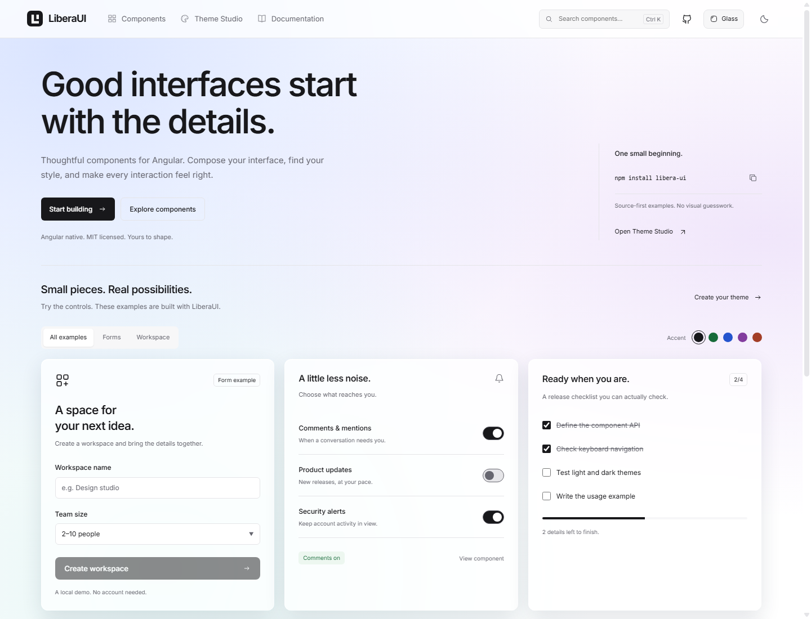
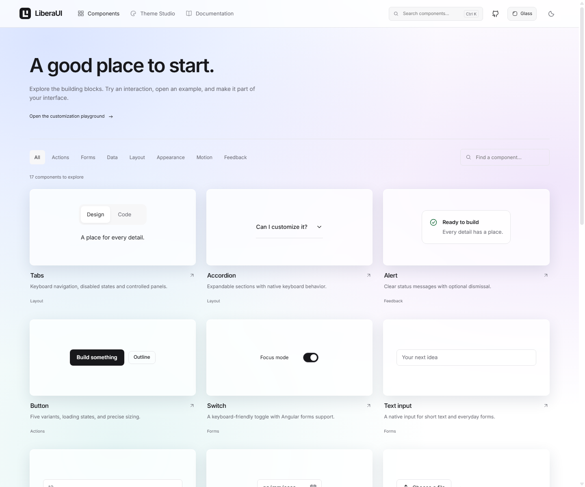
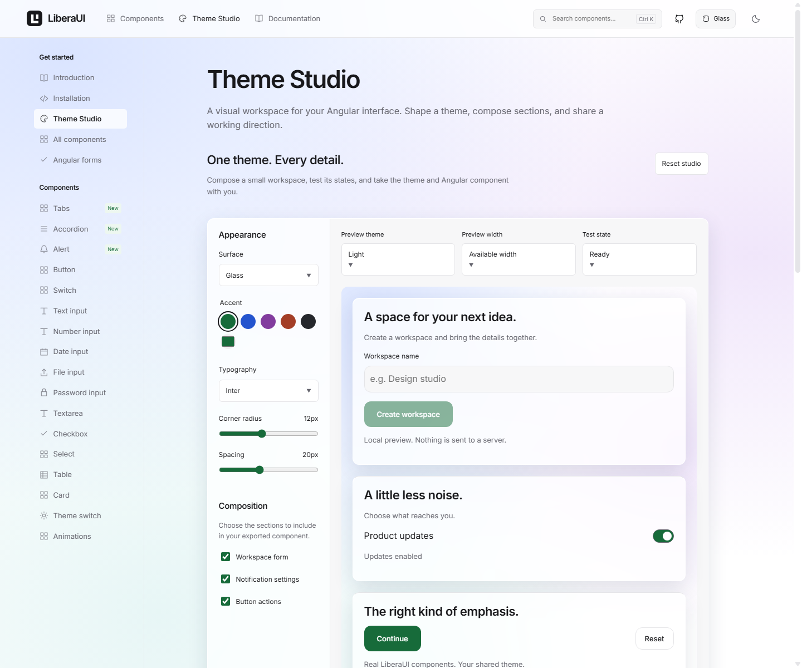

<div align="center">


# LiberaUI

### Good interfaces start with the details.

Thoughtful Angular components. A shared visual language. A playground to make them yours.

[Explore the demo](https://gioelevalori.github.io/liberaui/) · [Components](https://gioelevalori.github.io/liberaui/#/components) · [Live playground](https://gioelevalori.github.io/liberaui/#/playground) · [Contribute](CONTRIBUTING.md)

[](https://github.com/gioelevalori/liberaui/actions/workflows/pages.yml)
[](LICENSE)
[](https://angular.dev/)

</div>

[](https://gioelevalori.github.io/liberaui/)

> **LiberaUI 0.5.1:** Glass by default on the site, accessible interface patterns, themed pickers and Angular forms support.

## Your interface, your details

LiberaUI is an open source Angular component library for people who care about how an interface looks and feels. Explore real components, adjust their appearance, and take the example into your application.

- **Theme Studio.** Tune accent, typography, radius and spacing across a workspace preview. Choose sections, test states, download CSS and an Angular component, or share a configuration link.
- **Keep a consistent style.** The library and showcase share typography, colors, surfaces and theme tokens.
- **Build with Angular.** Standalone components, button variants and loading states, plus a switch with Angular forms support.
- **Explore real examples.** Try workspace forms, notification settings, checklists and team controls in the demo.
- **Make it yours.** Light and dark themes, locally bundled Inter fonts and an MIT license.

The visual direction takes inspiration from the clarity of shadcn/ui and Radix. The components are implemented in Angular, with LiberaUI's own geometric logo.

## See the components

[](https://gioelevalori.github.io/liberaui/#/components)

[Browse the catalog →](https://gioelevalori.github.io/liberaui/#/components)
[Try the live customization playground →](https://gioelevalori.github.io/liberaui/#/playground)

## Try the latest source

> **Latest release: 0.5.1.** Angular 17–21 peer compatibility, CSS animations without an animation provider, and isolated form-control styles.

Use Node.js 22 and npm:

```sh
git clone https://github.com/gioelevalori/liberaui.git
cd liberaui
npm ci
npm start
```

Open [localhost:4200](http://127.0.0.1:4200). The workspace uses Angular 19. The library declares peer support for Angular 17–19; the current CI verifies Angular 19 only.

### Use the library

The published package is available with:

```sh
npm install libera-ui@^0.5.1
```

Add `ButtonComponent` to your standalone component's imports:

```ts
import { ButtonComponent } from 'libera-ui';
```

```html
<lib-button variant="outline" [radius]="12" size="comfortable">
  Create something
</lib-button>
```

Import the shared theme once in your global stylesheet:

```css
@import 'libera-ui/theme.css';
```

The theme includes the locally bundled Inter fonts and shared design tokens. Use `dark-theme` on the body, or the library's theme switch, to enable dark mode. The theme export is included in version 0.2.0.

## Theme Studio

[](https://gioelevalori.github.io/liberaui/#/playground)

Open the [Studio](https://gioelevalori.github.io/liberaui/#/playground) to compose workspace, notification and action sections. Switch between light and dark previews, check a narrow layout, and try loading, disabled, error and long-content fixtures.

Download both files: import `libera-ui/theme.css` followed by `liberaui-theme.css` in your global stylesheet, then use the exported standalone `WorkspaceComponent`. The exported example starts in the ready state and keeps its interactions local. The mobile preview is constrained to 360px or the available width, whichever is smaller.

Share links contain versioned theme and section settings in the URL. They do not save form values or send data to a server. Anyone with the link can read the configuration.

Version 0.3.0 exposes typed helpers:

```ts
import { createThemeCss, DEFAULT_THEME } from 'libera-ui';
const css = createThemeCss({ ...DEFAULT_THEME, accent: '#2454ce', radius: 16 });
```

## Glass material


Glass is an optional surface treatment, independent of light and dark mode. Use the **Glass** button in the desktop header or mobile menu to try it on the site. In Theme Studio choose **Surface → Glass**; share links and Angular exports keep the selection.

The Glass stylesheet is included by `libera-ui/theme.css` in version 0.4.0 and later. You can also import `libera-ui/glass.css` separately when you already provide the core theme tokens.

```html
<div class="lib-glass lib-glass-backdrop">
  <section class="lib-glass-panel">Your content</section>
</div>
```

Set `data-glass-mode="dark"` on a scoped Glass container to preview dark material, or use the body’s `dark-theme` class in your app. Translucency falls back to opaque surfaces without backdrop-filter support and when reduced transparency is requested.

## New in 0.5.1

- Angular 20 and 21 are included in the peer dependency range.
- CSS transitions replace legacy Angular animation triggers; no animation provider is required.
- Shared field styles are scoped to library hosts and no longer affect unrelated application inputs.
- Templates and styles live in separate files, with formatting verified in CI.

## Added in 0.5.0

- **Glass by default on a fresh site visit**, with saved Essential preferences respected.
- **Tabs**, **Accordion** and **Alert** components, including keyboard navigation and dismissible feedback.
- **Angular forms support** for text, number, password, date, textarea, select and checkbox controls.
- **Themed pickers.** A keyboard-friendly calendar with date limits, plus coordinated select menus in browsers supporting customizable selects. Other browsers keep their native select menu.
- **Icons and motion.** Shared SVG icons, compact mobile controls and transitions that respect reduced motion.
- **Forms lab** showing live reactive values, reset and disabled behavior.
- Fixes for initial select values, numeric values, password reveal, numeric bounds and empty Studio submission.

Import the components you use into your standalone component:

```ts
import { FormControl, ReactiveFormsModule } from '@angular/forms';
import { InputTextComponent, TabComponent, AccordionComponent, AlertComponent } from 'libera-ui';
const name = new FormControl('Design studio');
```

```html
<lib-input-text label="Workspace name" [formControl]="name" />
<lib-alert title="Ready" tone="success">Your workspace is ready.</lib-alert>
```

Use `TabItem[]` with `[(activeId)]` for Tabs, and `AccordionItem[]` with `[(openIds)]` for Accordion. Each item needs a unique ID. Install libera-ui@^0.5.0 to use these APIs.

## Build something with us

Small improvements are welcome: a clearer example, a bug fix, a keyboard interaction or a new component.

1. [Report a bug or propose an idea](https://github.com/gioelevalori/liberaui/issues).
2. Read the [contribution guide](CONTRIBUTING.md).
3. Fork the repository and open a pull request.

For a large change, start with an issue so we can agree on the direction. Maintainers review contributions before merging.

If you find LiberaUI useful, share something you built with it or star the repository to help others discover it.

<details>
<summary><strong>Development and deployment</strong></summary>

### Local checks

```sh
npm run build
npm run build:lib
npm test
```

Tests use ChromeHeadless. Set `CHROME_BIN` if Chrome is installed outside the standard path.

### GitHub Pages

Pushes to `master` build the library, run tests, build the demo with the `/liberaui/` base path, and deploy to GitHub Pages. Pull requests run the checks without deploying.

Pages must use GitHub Actions as its source. Hash routes support direct links and refresh without custom server routing.

</details>

## License

Created by [Gioele Valori](https://github.com/gioelevalori). Released under the [MIT license](LICENSE).

Copyright (c) 2025 Libera-UI. You may use, modify and redistribute the code, including commercially, while preserving the copyright and license notice in copies or substantial portions.

Inter is bundled under its [SIL Open Font License](projects/libera-ui/fonts/LICENSE).
